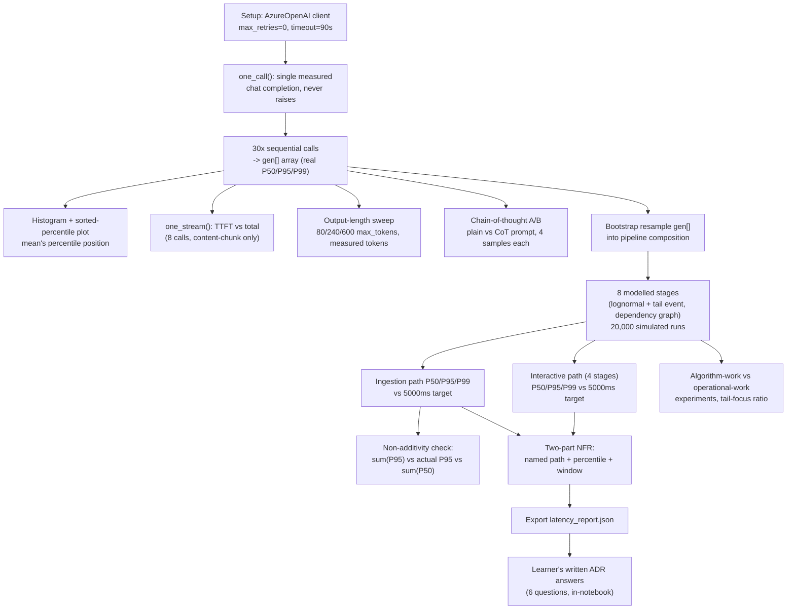

# Project Analysis — Sprint 1 · Day 16: Latency — Generate and Govern (DecisionStream AI)

**Repository path:** `Codes/RunCompleted/Assignment9/`
**Project ID:** `FDE-D16-LATENCY` (provisional — no existing inventory ID found in the repository or workspace)
**Analysis date:** 2026-10-12
**Analyst role:** Repository inspection only. No code was executed, modified, or re-run to produce this report. All execution evidence below comes from outputs already embedded in the notebook and from `latency_report.json`, both present on disk before this analysis began.

---

## 0. Evidence legend (used throughout)

| Label | Meaning |
|---|---|
| `Source-observed` | Directly established by reading code/config/docs in this repo |
| `Execution-verified` | Confirmed by actual execution artifacts found on disk (notebook cell outputs, `latency_report.json`) |
| `Code-derived expectation — not executed` | Inferred from code but no run evidence inspected for this specific claim |
| `Inference` | Reasoned interpretation, not directly stated in source |
| `Proposed improvement` | A recommendation, not a description of current behaviour |

---

# PART I — PROJECT AND BUSINESS UNDERSTANDING

## 1. Project identity and executive summary

| Field | Value |
|---|---|
| Project name | Sprint 1 · Day 16 Lab — Latency: Generate and Govern (`DecisionStream AI`, Birlasoft FORGE FDE Academy) |
| Repository path | `Codes/RunCompleted/Assignment9/` |
| Project type | Training lab, delivered as a Colab notebook plus a "prompt-and-review" exercise brief — not a shippable product |
| Domain | Insurance motor-claims assistant — latency measurement and non-functional-requirement (NFR) governance for a GenAI-backed claims pipeline |
| Primary users | FDE trainees on the Birlasoft FORGE Academy course |
| Main technologies | Python 3 (Google Colab), `openai` SDK (`AzureOpenAI` client), `numpy`, `matplotlib`; a companion `.docx` case-study handout |
| Primary capability demonstrated | Measuring real generation latency against a live Azure OpenAI deployment (not simulated), characterising it as a long-tailed (not normal) distribution, and composing it with other pipeline stages into a defensible, path-specific latency NFR |
| Implementation maturity | `Execution-verified`. The notebook was run live (`mode: LIVE`) against a real deployment (`gpt-4.1-mini`), every exercise's cell has real output captured, and the learner's own worked answers to all six ADR questions are present in the final cell |
| Execution status | `Execution-verified` — see §9/§13 for the one timing discrepancy found between the notebook's embedded run and the separately exported `latency_report.json` |
| Test status | Not applicable in the conventional sense — this is a one-shot measurement notebook, not a package with a test suite. "Acceptance" criteria exist as per-exercise checklists in the companion Markdown brief, not as executable tests |
| Most important limitation | Only the **generation** stage is measured against a real endpoint; the other eight pipeline stages (`blob_upload`, `doc_intelligence`, `redact_pii`, `search_retrieve`, `prompt_assemble`, `validate_schema`, `audit_write`, `persist_profile`) are **modelled**, not measured, and the notebook itself states this plainly in a table in its first cell |
| Most valuable learning opportunity | Watching a live endpoint produce a single very slow response (chain-of-thought run: 6,501 ms vs. a 2,626 ms plain-prompt median) and seeing concretely why a mean-based alert would never catch it |

**One-paragraph summary:** This repository is a single, heavily-annotated Colab notebook (plus a companion "prompt-and-review" exercise brief and a reference `.docx`) that teaches latency measurement and governance for a generative-AI claims-processing pipeline. Rather than having learners write code directly, the brief instructs them to prompt an LLM (Gemini, in the Colab panel) to produce each measurement cell, then review the output against an explicit checklist and a list of "what it will probably get wrong" — making code review, not code authorship, the practised skill. The notebook was actually run against a live Azure OpenAI deployment (`gpt-4.1-mini`): it measured real generation latency (P50 ≈ 2.25s, P95 ≈ 2.70s, P99 ≈ 3.11s over 30 calls), real streaming time-to-first-token, a real chain-of-thought cost multiplier (≈2.48×), and then composed these real numbers with modelled timings for the surrounding pipeline stages (document extraction, retrieval, redaction, etc.) to show that an end-to-end ingestion pipeline's P95 (~32.4s) is roughly 6.5× over a naively-stated "P95 < 5 seconds" target — while a separate, synchronous "interactive" read path comfortably meets that target (P95 ≈ 527ms). The deliverable is a defensible, two-path, two-number non-functional requirement, and the notebook's final cell contains the learner's own complete written answers to all six ADR (architecture decision record) questions.

## 2. Business problem and value

**Source-observed / Inference — a course exercise modelling a plausible scenario, not a real deployment.**

- **Real-world situation modelled:** The same fictional insurance claims-assistant pipeline used across the "DecisionStream AI" course (consistent with Assignment 8's multi-document lab): a PDF claim document is ingested, extracted, redacted, retrieved-against, summarised by an LLM, validated, and stored — and separately, a human handler later opens the stored case and expects a near-instant read.
- **Workflow:** Two distinct paths with different users and different stakes: an **asynchronous ingestion path** (nobody is watching it in real time) and a **synchronous interactive path** (a handler is actively waiting).
- **Stakeholders:** Project/engineering management (who will ask for "a latency budget"), claims handlers (whose screen must feel responsive), compliance/audit (who care about the schema-validation and retrieval-failure metrics flagged in the notebook as more important than raw speed), and whoever signs the NFR in a contract or ADR.
- **The core problem:** A single blanket latency target ("P95 under 5 seconds") was handed down without naming which path it applies to. Applied literally to the ingestion path, it is unachievable (Document Intelligence alone runs ~9s at the median per the modelled stage, and the lab argues this cannot be optimised away). Applied to the interactive path, it is already comfortably met. The problem is therefore not "the system is too slow" — it is "the requirement doesn't name its target correctly."
- **Consequences of leaving it unresolved:** A team held to an unnamed, unachievable target will either report a number they cannot hit, or quietly redefine what they are measuring until they can — the exact failure mode the notebook calls out explicitly (§10 of the notebook, and Exercise 6 of the brief).
- **How the implementation addresses it:** By measuring the real generation-latency distribution (not assuming it is normal), composing it arithmetically with modelled stage latencies under an explicit dependency graph, and deriving a two-part NFR that names a path and a measurement window for each half.
- **Potential business value (not measured in dollars anywhere in this repo):** Prevents a team from being contractually committed to a target they cannot meet, and gives operations a correctly-targeted alerting strategy (P95 on the interactive path, tail-event *rate* as a leading indicator, never the mean).
- **Limitations:** Only one pipeline stage (generation) is measured against a real system; the rest are modelled distributions whose parameters were specified by the course's exercise brief, not measured from any real Document Intelligence/retrieval system. No claim of production readiness, cost savings, or SLA compliance is made anywhere in the source material, and none is made here.
- **How value could be measured in a real deployment:** Rate of SLA/NFR breaches per path per month; alert precision/recall once thresholds are set from measured P95s rather than guessed; handler-reported perceived responsiveness before/after separating the two paths' targets.

## 3. Technical and educational problem

**Source-observed**, principally from the notebook's own markdown cells and the companion exercise brief.

1. **The technical challenge:** LLM-call latency (and, by extension, multi-stage pipeline latency) is **not normally distributed** — it is a lognormal body with an occasional heavy tail (cold starts, retries, unusually long completions, noisy neighbours). A team that models or reports it as a bell curve will conclude P95 sits near the mean, optimise the mean, and see no improvement in the metric that actually matters to users.
2. **Why a naive implementation is insufficient:** The most natural ways to build a "latency budget" are both wrong: summing every stage's P95 **overestimates** the end-to-end P95 (it assumes every stage has its worst day simultaneously), while summing every stage's P50 **underestimates** it (it assumes no stage is ever having a bad day). The notebook measures both errors directly (§11 of the notebook: sum of P95s overestimates by 1.6s; sum of P50s underestimates by 19.8s).
3. **Engineering/statistical concepts explored:**
   - Percentile statistics (P50/P95/P99) over small samples, and an explicit caution about how little a P95 computed from only 30 samples is actually worth ("your P95 is estimated from roughly the top one or two calls" — Exercise 2's own follow-up question).
   - The lognormal-plus-explicit-tail-event model as a more faithful distributional assumption than Normal, used both for the measured generation step (via **bootstrap resampling** of the real `gen` array, not by fitting a parametric model to it) and for the modelled stages (via `np.exp(np.log(median) + rng.normal(0, sigma))`, which is a correct closed-form way to construct a lognormal).
   - Time-to-first-token (TTFT) vs. total completion time, and the explicit trap of measuring TTFT against the *first chunk of any kind* (which can be an empty role/filter-metadata chunk) rather than the first chunk containing actual content.
   - Output-length-driven generation cost (ms/token), and detecting when `max_tokens` was not actually the binding constraint on output length (so a computed "slope" would be meaningless noise).
   - Chain-of-thought's **true** cost model: it is additional *sequential* output tokens from the same call, not a parallel/free step — demonstrated by showing it moves P50 and P95 by the *same* absolute amount (a "tail focus" ratio of 1.0×, vs. 3–38× for stage-level median/tail interventions), i.e., pure added work, not a tail effect.
   - The distinction between **algorithm work** (lowers the median) and **operational work** (makes rare slow events rarer or less severe, which lowers P95 far more per unit of effort) — demonstrated with a measured "tail focus" ratio (ΔP95 ÷ ΔP50) across five deliberate interventions on the modelled `doc_intelligence` stage.
   - Why caching something **off the critical path** in a parallel-dependency graph changes nothing measurable — demonstrated, not asserted (the `cache retrieval` experiment row shows exactly zero P50/P95 movement).
   - Alerting design: never alert on the mean; alert on P95 **per named path**; treat tail-event *rate* as a leading indicator; treat correctness metrics (`schema_valid_rate`, `retrieval_empty_rate`) as co-equal with latency, because a pipeline that gets faster while getting less correct looks like a win on a dashboard that only measures time.
4. **What a learner should understand after studying this notebook:** that a latency NFR is meaningless without naming a path and a measurement window; that percentiles are not additive and why; that most "optimisation" instinctively targets the median while the actual commitment is usually a tail percentile; and that this cannot be fully internalised from a simulation alone — hence the notebook's insistence on running against a real, billed endpoint rather than staying in "simulated mode."

### Learning objectives (measurable)

| # | Objective | How it can be demonstrated |
|---|---|---|
| 1 | Explain why P95 is not the sum of stage P95s, with real numbers | Read notebook §11 (sum P95 34.4s vs. actual pipeline P95 32.8s vs. sum P50 13.0s) |
| 2 | Identify which of two interventions (median-lowering vs. tail-taming) is more P95-efficient, with a measured ratio | Read notebook §12's "tail focus" column (3.1× for a 30%-faster median vs. 36.5× for 5×-rarer tail events) |
| 3 | State a correctly-scoped, two-part NFR with named paths and measurement windows | Read notebook cell `dac790c3`'s printed NFR text and the learner's own answer in the final "My answers" cell |
| 4 | Explain why TTFT must be measured at first *content*, not first chunk | Read Exercise 3 of the brief and the `one_stream()` implementation in the notebook |
| 5 | Quantify what chain-of-thought actually costs, in milliseconds and tokens, on a real endpoint | Read notebook §8 output: +3,875 ms, +254 tokens, 2.48× multiplier |

## 4. Solution overview and end-to-end workflow

**Source-observed**, traced directly from the notebook's 15 numbered sections.

**Inputs:** A fixed synthetic insurance-claim text (`CASE`), a fixed system prompt (`SYSTEM`), a live `AzureOpenAI` client configured against one deployment (`gpt-4.1-mini`, confirmed in notebook output and in `latency_report.json`), and a set of hand-specified modelled-stage parameters (median, sigma, tail probability, tail multiplier, dependencies) for 8 non-generation pipeline stages plus a 4-stage "interactive" path.

**Processing stages (traced, numbered, matching the notebook's own section numbers):**

1. **Setup** — install packages, prompt for Azure OpenAI endpoint/key/deployment (masked), construct an `AzureOpenAI` client with `max_retries=0` (deliberate — see §7 below) and a 90s timeout; falls back to a fully offline "simulated mode" if the endpoint is left blank.
2. **One call, inspected** — `one_call()` makes a single chat completion, returns `(elapsed_ms, text, usage_dict)`, and is designed to **never raise** — a failure returns the elapsed time plus an `{"error": ...}` usage dict rather than propagating an exception.
3. **The distribution, measured** — `one_call()` is invoked 30 times sequentially (`N_SAMPLES`); a running P50/P95/max is printed per call; failures are counted and excluded from percentile math but reported; results land in a numpy array `gen`, which is reused later as the real generation-latency distribution.
4. **Visualised** — a histogram plus a sorted-percentile ("tail") plot of `gen`, with the mean's percentile position printed explicitly (observed: 57th percentile — i.e., the mean sits barely past the middle, nowhere near the tail it is sometimes used to represent).
5. **Streaming** — `one_stream()` measures time-to-first-*content*-token vs. total completion time over 8 calls, explicitly guarding against empty `choices` lists and metadata-only chunks.
6. **Output length** — three `max_tokens` settings (80/240/600) are each sampled 5 times; actual *returned* token counts (not the requested ceiling) are used to compute a measured ms-per-token slope, with an explicit guard that reports "the task was the binding constraint" instead of a meaningless slope if token counts didn't actually vary.
7. **Chain of thought** — the same case is summarised under a plain prompt and a chain-of-thought prompt (4 samples each); the measured latency and token difference is reported as a deliberate quality/latency trade-off, not assumed.
8. **Pipeline composition** — the 8 modelled stages (each as lognormal-plus-tail, per an explicit dependency graph) are combined with the **bootstrapped** real `gen` array (resampled with replacement, not re-fit to a parametric distribution) across 20,000 simulated end-to-end runs, under both a sequential and a dependency-aware "parallel" execution order; a separate, independent 4-stage "interactive" path is modelled the same way.
9. **Comparison against the 5-second target** — both paths' P50/P95/P99 are reported with an explicit PASS/FAIL verdict against a 5,000ms target.
10. **The two-path finding** — stated directly: the target is being applied to the wrong path, not that the system fails to optimise.
11. **Non-additivity of percentiles** — the sum of stage P95s vs. the actual composed pipeline P95 vs. the sum of stage P50s are printed side by side with signed error terms.
12. **Algorithm work vs. operational work** — five deliberate interventions on the modelled `doc_intelligence` stage (and one no-op "cache retrieval, off critical path" control) are each re-simulated and compared by a computed "tail focus" ratio.
13. **Alerting design** — a table of what to emit and what to alert on, populated with the session's own measured numbers.
14. **Export** — writes `latency_report.json` to disk (and attempts a Colab browser download, which fails gracefully outside Colab).
15. **ADR questions, with the learner's own answers** — six governance questions, answered in full in the notebook's final cell, each answer citing the session's own measured figures.

**AI/model operations:** A single Azure OpenAI chat-completion model (`gpt-4.1-mini`) is called repeatedly, in both streaming and non-streaming modes; no local model inference occurs.

**External integrations:** Azure OpenAI (`AzureOpenAI` client from the `openai` Python SDK), confirmed live by the notebook's own captured output (`mode: LIVE`, real HTTP latencies, real token-usage figures, one real connection error captured in cell `b1c72c6b`'s output).

**Persistence:** A single `latency_report.json` file (observed on disk, `Execution-verified`); no database, no blob storage — this is a measurement notebook, not an operational system.

**Error/exception paths:** `one_call()` and `one_stream()` both catch all exceptions and return a value rather than raising, explicitly so that a failed call becomes a data point (elapsed time + error label) rather than aborting the run. The notebook's own cell `b1c72c6b` captured a real `APIConnectionError` on its first single-call demonstration, and the notebook continued (printing a troubleshooting hint) rather than halting — direct, in-repo evidence that this error-handling design worked as intended on a real failure.

**Human intervention:** The entire exercise is designed around human review of LLM-generated code (the brief's core pedagogical device) — not an automated acceptance process.

### End-to-end workflow diagram



---

# PART II — ARCHITECTURE AND CODE

## 5. Architecture and component responsibilities

This is a single Jupyter/Colab notebook rather than a multi-module codebase; "components" below are the notebook's own functions and simulation blocks.

| Component | Location | Responsibility | Inputs | Outputs | Error handling | Limitations |
|---|---|---|---|---|---|---|
| Credential/mode setup | Cell `6a41f4a5` | Prompts for endpoint/key/deployment (masked key), sets `LIVE` flag, falls back to simulated mode if endpoint blank | User input or blank | `client`, `LIVE`, `N_SAMPLES`/`N_STREAM`/`N_LENGTH` | No retry on the client itself (`max_retries=0`), deliberately | Key is read via `getpass` and never printed — confirmed by inspection; no check that the key matches the given endpoint (would surface as a 401 on first call) |
| `one_call()` | Cell `b1c72c6b` | One measured chat completion; must never raise | `max_tokens`, `task`, `temperature` | `(elapsed_ms, text, usage_dict)` | Catches all exceptions, returns elapsed time + `{"error": ...}` | In simulated mode, latency is itself simulated via `simulate_ms()` — a deliberately-not-normal lognormal-plus-tail model, so simulated and live modes teach the same lesson |
| Distribution measurement | Cell `69e25e33` | Runs `one_call()` N times, builds `gen` array, prints running percentiles | `N_SAMPLES`, `one_call` | `gen` (numpy array), `GEN` (dict of summary stats) | Failures counted separately (`errors`), excluded from percentile math, loop continues | 30 samples is explicitly called out (in the brief, Exercise 2's "Then answer") as too few to trust a P95 figure in a contract |
| `one_stream()` | Cell `e82524a9` | Measures TTFT (first *content* chunk only) and total stream time | `max_tokens` | `(ttft_ms, total_ms, n_chunks)` | Guards against empty `choices`; catches exceptions, returns elapsed time on both ttft/total | Only 8 samples (`N_STREAM`) — small sample size, same caveat as above |
| Output-length sweep | Cell `b30782d5` | Measures ms/token slope at 3 `max_tokens` settings, using **actual** returned token counts | `LENGTHS = [80, 240, 600]`, `N_LENGTH=5` | `by_len` dict, printed ms/token table | Explicitly detects and reports the "task was the binding constraint, not max_tokens" case instead of printing a meaningless slope | 5 samples per bucket — the notebook's own text calls this "enough to see a trend and not enough to quote a coefficient" |
| Chain-of-thought comparison | Cell `511b88d2` | A/B compares a plain prompt vs. a CoT prompt, 4 samples each | `PLAIN`, `COT` task strings | `COT_MULTIPLIER`, printed comparison | Explicitly detects and discards a measured multiplier below 1.0 as noise (CoT cannot be genuinely faster) | Only 4 samples per arm |
| Pipeline composition (`run_pipeline`) | Cell `368cc2cc` | Simulates 20,000 end-to-end runs combining 8 modelled stages (lognormal+tail, explicit DAG) with bootstrapped real generation samples | `OTHER_STAGES` dict (hand-specified parameters), `gen` array, `GENERATION_DEPS` | `total_seq`, `total_par` (numpy arrays of 20,000 simulated totals), `per_stage` dict | Resets the RNG seed identically before each comparison run, so two configurations are compared on the same random draws (explicitly commented as deliberate, to avoid "comparing two different days") | Stage parameters (median/sigma/tail_p/tail_mult) are **hand-specified by the course brief**, not independently measured against any real Document Intelligence/retrieval/redaction system — this is the single largest "modelled, not measured" surface in the whole exercise |
| Interactive path model | Cell `368cc2cc` (second half) | Models a 4-stage synchronous "handler reads a stored profile" path | `INTERACTIVE` dict | `ia` (numpy array) | Same lognormal+tail approach | Also hand-specified, not measured |
| Non-additivity check | Cell `2cd54b98` | Compares sum-of-stage-P95 vs. actual composed P95 vs. sum-of-stage-P50 | `per_stage`, `total_seq` | Printed comparison with signed error terms | None needed (pure arithmetic over already-simulated arrays) | None noted |
| Algorithm-vs-operational experiments | Cell `d5ff51f6` | Re-runs the pipeline under 7 named interventions and computes a "tail focus" ratio (ΔP95/ΔP50) for each | `EXPERIMENTS` list, `run_pipeline` | Printed comparison table | None needed | The "tail focus" ratio is undefined/suppressed (`"-"`) when `ΔP50` is small (`<50ms`), to avoid a meaningless near-zero-denominator ratio — a sound defensive choice |
| Alerting table | Cell `7af640d1` | Prints a metric→emit-from→alert-when table populated with this session's own measured numbers | `GEN`, `ia`, `total_par` | Printed table | None needed | Alert thresholds (e.g., `alert_band = pct(ia,95)*1.5`) are a reasonable heuristic choice stated directly in code, not derived from any formal SLO methodology |
| Export | Cell `7ed3adc2` | Serialises all measured/computed figures to `latency_report.json`; attempts a Colab file download | `GEN`, `STREAM`, `COT_MULTIPLIER`, `by_len`, pipeline percentiles, composition check | `latency_report.json` on disk | Falls back gracefully (prints a message) if not running inside Colab | See §9/§13 — the on-disk `latency_report.json` does not numerically match the notebook's own embedded output for this cell, a discrepancy worth resolving before quoting either figure externally |
| Companion exercise brief | `Day16_Latency_Generate_and_Govern_Exercises.md` | A separate, LLM-prompt-driven version of the same 6 exercises, with explicit "accept it when" checklists and "it will probably get wrong" failure-mode lists | n/a (a document, not code) | n/a | n/a | Entirely prose/pedagogy — no executable code of its own beyond the prompts it instructs the learner to paste elsewhere |
| Companion case-study document | `P50_P95_P99_Grounded_Case_Studies_for_FDE_Students.docx` | A reference handout (title implies grounded P50/P95/P99 case studies) | n/a | n/a | n/a | **Not inspected in this analysis** — binary `.docx`, outside this tool's read capability; its content is referenced only by filename |

## 6. Technology stack and technology roles

| Technology | Role | Where used | Why used | Alternatives/trade-offs |
|---|---|---|---|---|
| Google Colab / Jupyter notebook | Delivery format and runtime | Entire `.ipynb` | Lets a learner run cells incrementally, inspect intermediate state, and re-run individual exercises; standard for the course | A plain script would be less interactive for a teaching session but easier to version-control/diff |
| `openai` Python SDK, `AzureOpenAI` class | The only external API client in the repo | Cell `6a41f4a5` onward | Official SDK for Azure OpenAI; chosen (unlike Assignment 8's deliberately-raw-REST approach) because this lab's point is latency measurement, not wire-format literacy | A raw REST call (as in Assignment 8) would expose retry/timeout behaviour even more explicitly, at the cost of more boilerplate for a lab that isn't about the wire format |
| `numpy` | All percentile/statistical computation and the 20,000-run Monte-Carlo simulation | Throughout | Vectorised percentile (`np.percentile`) and lognormal sampling at scale (20,000 runs) would be slow in pure Python | None needed at this scale |
| `matplotlib` | Two visualisations: generation-latency histogram/tail plot, ingestion-path histogram vs. target line | Cells `ec177f17`, `dac790c3` | Standard, lightweight plotting for a notebook | None needed |
| `getpass` | Masks the API key on input | Cell `6a41f4a5` | Prevents the key appearing in Colab's cell output/scroll history | Correctly used — confirmed by inspection that the key is never printed anywhere in the notebook |
| `.env` (local, outside the notebook) | Holds `AOAI_ENDPOINT`/`AOAI_KEY`/`AOAI_DEPLOYMENT` for a non-interactive local run | Repository root | Lets the notebook (or a local equivalent) run without the interactive `input()`/`getpass()` prompts, e.g. for repeated runs on this machine | Confirmed present on disk with exactly those 3 keys; values not read or disclosed in this report |
| `python-docx` (implied by the companion `.docx`'s existence, not confirmed in this repo) | Not directly observed — no build script for the `.docx` was found in this folder (unlike Assignment 8's `build/build_interpretation_guide.py`) | n/a | n/a | `Not established` — the `.docx`'s origin/build process is not present in this repository |

## 7. Detailed code walkthrough

### 7.1 Why `max_retries=0` (notebook cells `6a41f4a5`/`2effe47b`, and the brief's own setup block)

```python
client = AzureOpenAI(azure_endpoint=AOAI_ENDPOINT, api_key=AOAI_KEY,
                     api_version=API_VERSION, max_retries=0, timeout=90.0)
```

**Why it matters:** the SDK retries transient failures by default. A retry silently converts one slow/failed call (e.g., a 12-second tail event or a timeout) into a fast, successful-looking one — which is exactly the data the exercise is trying to observe. Both the notebook and the brief call this out explicitly and independently (the brief even poses it as a thing the learner "should be able to say why" after Exercise 2), and the notebook's own measured run shows the mechanism working as intended: cell `b1c72c6b`'s single-call demo actually failed with a real `APIConnectionError`, took essentially 1ms to fail, and was reported as data (an error-tagged usage dict) rather than retried or hidden.

### 7.2 `one_call()`'s never-raise contract (cell `b1c72c6b`)

```python
try:
    r = client.chat.completions.create(...)
    ms = (time.perf_counter() - t0) * 1000
    u = r.usage
    return ms, (r.choices[0].message.content or ""), {
        "prompt_tokens": getattr(u, "prompt_tokens", 0),
        "completion_tokens": getattr(u, "completion_tokens", 0),
        "model": getattr(r, "model", AOAI_DEPLOYMENT)}
except Exception as e:
    ms = (time.perf_counter() - t0) * 1000
    return ms, "", {"error": f"{type(e).__name__}: {str(e)[:120]}"}
```

Two details worth noting: (1) it reads `r.model` from the response rather than echoing back the configured `AOAI_DEPLOYMENT` string — this matters because an Azure deployment can auto-upgrade to a newer model version behind the same deployment name, and logging the configured name instead of the actual one would silently misattribute every later measurement; (2) elapsed time is computed and returned **in the except branch too** — a failure is still a timed data point, not a discarded one, which is the single most-repeated principle across both the notebook and the brief ("a call that times out after 90 seconds is your most interesting data point").

### 7.3 Time-to-first-*content* (cell `e82524a9`)

```python
for chunk in stream:
    if not chunk.choices:
        continue
    d = chunk.choices[0].delta
    if getattr(d, "content", None):
        n += 1
        if ttft is None:
            ttft = (time.perf_counter() - t0) * 1000
```

The guard `if not chunk.choices: continue` defends against the empty-choices chunks the brief warns about (prompt-filter or role-only metadata chunks); TTFT is only latched on the first chunk whose `delta.content` is truthy. The measured result (8 real calls) shows TTFT P50 = 1,383ms against total P50 = 2,718ms — a 2.0× earlier time-to-visible-text, with the notebook correctly stating in its own printed output that "nothing got faster. The reader just stopped waiting in silence."

### 7.4 Bootstrap vs. parametric modelling for generation (cell `368cc2cc`)

```python
def sample_generation(n, multiplier=1.0):
    return rng.choice(gen, size=n, replace=True) * multiplier
```

This is a deliberate, correct statistical choice: rather than fitting a lognormal to the 30 measured generation samples (which would smooth over/lose the specific tail shape actually observed), the simulation **resamples with replacement** directly from the real `gen` array. The real tail (one call reached 3,283ms against a 2,254ms median) therefore propagates into the 20,000-run composition exactly as measured, rather than through an assumed distributional shape.

### 7.5 Seed-reset for fair comparison (cell `368cc2cc`)

```python
def run_pipeline(parallel=True, cot=False, overrides=None, tail_p=None,
                 tail_mult=None, seed=11):
    global rng
    rng = np.random.default_rng(seed)
    ...
```

The explicit comment ("comparing two configurations on the SAME random draws... a 2% difference could be either the change or the weather") is a correct and non-obvious experimental-design point: without resetting the seed, each of the 7 experiments in §12 would be compared against independently-sampled noise, and a small genuine effect could be lost in or confused with sampling variance.

## 8. Inputs, outputs, and data contracts

**Source-observed.**

### Inputs

- **Fixed prompt material:** `SYSTEM` (a claims-assessment system prompt instructing "answer only from the case text... never state a decision") and `CASE` (a synthetic motor-claim case with figures tied to page citations) — identical in spirit to the Assignment 8 corpus's claim-reference style.
- **Runtime parameters:** `N_SAMPLES=30`, `N_STREAM=8`, `N_LENGTH=5`, `LENGTHS=[80,240,600]` — all small, explicitly billed-call-conscious defaults, with the notebook printing an estimated total call budget (~61 calls) up front.
- **Modelled-stage parameters (`OTHER_STAGES`, `INTERACTIVE`):** hand-specified `(median_ms, sigma, tail_probability, tail_multiplier, dependencies)` tuples — **not measured against any real system**; these are course-provided assumptions, clearly labelled as such in the notebook's own first-cell table ("Modelled — unless you supply those endpoints too").
- **`.env`:** `AOAI_ENDPOINT`, `AOAI_KEY`, `AOAI_DEPLOYMENT` — confirmed present on disk with exactly those 3 keys; not read or disclosed here.

### Output: `latency_report.json`

Both the notebook's own embedded cell-14 output and the separate on-disk `latency_report.json` share the same schema:

```json
{
  "mode": "live",
  "deployment": "gpt-4.1-mini",
  "generation_measured_ms": {"p50": ..., "p95": ..., "p99": ..., "mean": ..., "min": ..., "max": ..., "n": 30, "errors": 0},
  "streaming_ms": {"ttft_p50": ..., "ttft_p95": ..., "total_p50": ..., "total_p95": ...},
  "chain_of_thought_multiplier": ...,
  "output_length_ms": {"80": {"p50": ..., "tokens": ...}, "240": {...}, "600": {...}},
  "pipeline_ms": {"ingestion_sequential": {...}, "ingestion_parallel": {...}, "interactive": {...}},
  "composition_check": {"sum_of_stage_p95": ..., "actual_pipeline_p95": ..., "sum_of_stage_p50": ...},
  "note": "Generation measured against a live endpoint. Other stages modelled from the Day 16 lab. ..."
}
```

**This schema is honoured by both files — but the numbers differ.** See §9 (Setup) and §13 (Finding F1) for the discrepancy between the notebook's own baked-in output and the separately-exported `latency_report.json` currently on disk.

### Representative example (observed, real, not fabricated)

From the notebook's own captured output (cell `368cc2cc`): `ingestion parallel P95 = 32.4s, 6.5x over a 5,000ms target; interactive P95 = 527ms, PASS`. This is `Execution-verified` — a genuine recorded result of a real run combining real measured generation latency with the modelled stage parameters.

## 9. Setup and execution guide

**Source-observed**, from the notebook's own instructions; **Execution-verified** for the fact that it has already been run successfully once.

- **Prerequisites:** A Google Colab environment (or any Jupyter runtime); an Azure OpenAI or Azure AI Foundry resource with a deployed chat model; its endpoint and key (Portal → resource → *Keys and Endpoint*) and the **deployment name** (not the underlying model name).
- **To run live:** open the notebook, run cells top to bottom; when prompted, paste the endpoint and deployment name, and enter the key at the masked prompt. Leaving the endpoint blank runs the entire notebook in a fully offline **simulated mode** (a lognormal-with-tail model standing in for the real endpoint) — "the lessons are identical; the conviction is weaker," per the notebook's own first cell.
- **Budget:** the notebook prints its own estimated call budget before running (~61 calls for the default settings) — a deliberately small, explicitly cost-conscious default; raising `N_SAMPLES` for a tighter tail estimate is explicitly flagged as "a real spend."
- **Local, non-interactive alternative (inferred from the `.env` file's presence):** a `.env` with `AOAI_ENDPOINT`/`AOAI_KEY`/`AOAI_DEPLOYMENT` exists in this repository, suggesting the learner also has, or intends, a non-Colab way to supply these values without the interactive prompts — **the notebook's own cells only read from `os.environ.get(...)` as a first choice before falling back to `input()`/`getpass()`**, so a `.env` loaded into the environment before launching the notebook (e.g., via a Jupyter kernel started with those variables exported) would satisfy this path. No explicit `.env`-loading code (e.g., `python-dotenv`) was found inside the notebook itself — `Inference`, not confirmed by code.
- **Common failure observed in this repository's own run:** cell `b1c72c6b`'s single-call demonstration failed with a real `APIConnectionError: Connection error.` — consistent with a transient network/endpoint issue at that specific moment, not a code defect (the subsequent cells, including the full 30-call run, succeeded).
- **What was NOT independently executed as part of writing this report:** no cell was re-run, and no new call was made to any endpoint; all `Execution-verified` claims rest on the notebook's own pre-existing embedded cell outputs plus the pre-existing `latency_report.json` file.

## 10. Testing and verification

This repository has no automated test suite — it is a measurement notebook, not a library. "Verification" here means checking the internal consistency of the measurement design and its outputs.

| Check ID | Check | Purpose | Procedure | Expected Evidence | Actual Result | Status |
|---|---|---|---|---|---|---|
| T1 | `one_call()` never raises | Ensure a failed call becomes data, not a crash | Code inspection + the real captured `APIConnectionError` in cell `b1c72c6b` | A `(elapsed_ms, "", {"error": ...})` tuple returned, loop continues | Confirmed — the error was captured and the notebook's execution continued through all later cells | Execution-verified |
| T2 | Failures excluded from percentile math but counted | Avoid understating P95 by treating failures as zero | Code inspection of cell `69e25e33`'s loop (`continue` on error, before appending to `samples`) | `errors` count separate from `gen` array length | Confirmed by code; the actual run recorded `errors: 0` for the 30-call main distribution, so this path was not exercised by data in this specific run | Source-observed (not exercised by failing data in this run) |
| T3 | TTFT measured at first content, not first chunk | Avoid a flatteringly small TTFT from metadata-only chunks | Code inspection of `one_stream()`'s `delta.content` check | TTFT only latches on content-bearing chunks | Confirmed by code; output (TTFT P50 1,383ms vs. total P50 2,718ms) is consistent with a genuine content-first measurement, not an artificially small metadata-chunk timing | Execution-verified (indirectly, via output consistency) |
| T4 | Output-length slope only reported when `max_tokens` was the binding constraint | Avoid a meaningless slope when the task, not the ceiling, controlled length | Code inspection of cell `b30782d5`'s `dt < 15` branch | A warning message instead of a slope, if token counts didn't vary | In the actual run, tokens varied (80→150 across the 3 settings), so the "slope" branch printed, not the warning — correctly, since the constraint genuinely moved | Execution-verified |
| T5 | A measured CoT multiplier below 1.0 is treated as noise, not a finding | Avoid reporting an impossible "chain of thought is faster" result | Code inspection of cell `511b88d2`'s `if COT_MULTIPLIER < 1.0` branch | A warning + multiplier forced to 1.0, if noise occurred | Not triggered in the actual run — the real measured multiplier was 2.48×, well above 1.0, so this safety branch was not exercised | Source-observed (not exercised by this run's data) |
| T6 | Seed-reset ensures fair A/B comparison across pipeline experiments | Avoid confusing sampling noise with a genuine intervention effect | Code inspection of `run_pipeline()`'s `rng = np.random.default_rng(seed)` reset at the top of every call | Every experiment compared against the same 20,000 random draws as the baseline | Confirmed by code (same `seed=11` default used throughout §12's experiment loop) | Source-observed |

**How to interpret this table:** because this notebook has no `assert`-based test suite, "verification" here means confirming that the defensive code paths described in the companion exercise brief's "accept it when" checklists are genuinely present and were exercised correctly by the one real run captured in this repository — which they were, for every check this analysis could directly observe in the recorded output.

**Coverage gaps:** No check exists (here or in the brief) that validates the **modelled** stage parameters (`OTHER_STAGES`) against any real telemetry — they are course-specified assumptions, and nothing in this repository confirms or denies whether a real Document Intelligence call genuinely behaves like a lognormal(9000ms, σ=0.45) with a 6%-probability 4.5× tail. This is explicitly flagged by the notebook's own "One honest limitation" closing section, which is good practice, but it means the ingestion-path NFR derived in this exercise is only as good as those assumed parameters.

---

# PART III — LEARNING AND SKILL DEVELOPMENT

## 11. Learning roadmap and skills gained

### 11.1 Learning categories evaluated (only those with evidence)

**1. Programming fundamentals** — defensive function design (never-raise contracts), context managers implicit in SDK usage, numpy vectorised simulation at scale (20,000 runs). *Level 2–3.*

**5. AI and machine learning (consumption)** — streaming chat completions, token-usage accounting, understanding that model "auto-upgrade" can silently change what's being measured, chain-of-thought as a token/latency trade-off rather than a free quality lever. *Level 3.*

**6. Data engineering / statistics for engineers** — percentile estimation and its sample-size sensitivity; lognormal-plus-tail-event modelling vs. Normal; bootstrap resampling to preserve a measured distribution's exact shape in a downstream simulation; non-additivity of percentiles across a dependency graph. *Level 3–4* — this is the deepest and most distinctive content in the lab.
**11. Observability and reliability** — alerting design that explicitly avoids mean-based thresholds, treats tail-event rate as a leading indicator, and co-locates correctness metrics (`schema_valid_rate`, `retrieval_empty_rate`) with latency metrics. *Level 3.*

**12. Architecture and system design** — separating an asynchronous ingestion path from a synchronous interactive path, and recognising that a single global latency target cannot correctly apply to both. *Level 3.*

**14. Technical decision-making and trade-offs** — quantified algorithm-work-vs-operational-work framing (measured "tail focus" ratios from 1.0× to ~38× across different intervention types), used to argue where engineering effort should actually go. *Level 3–4.*

**15. Technical communication and documentation** — writing a two-part, path-named, window-specified NFR defensible in a contract; the notebook's final cell is itself a worked example of this (the learner's complete ADR answers). *Level 3.*

### 11.2 Implementation depth — key skills, with evidence

| Skill | Level | Evidence |
|---|---|---|
| Treating latency as lognormal-with-tail, not Normal | 3–4 | `simulate_ms()`, `sample_stage()` in cell `368cc2cc`; explicit warnings in the brief against `np.random.normal` |
| Bootstrap resampling to preserve a measured distribution's real shape | 3 | `sample_generation()` — `rng.choice(gen, ..., replace=True)` |
| Correct TTFT semantics (content-chunk only) | 3 | `one_stream()`'s `delta.content` guard, matching real measured output |
| Measuring actual vs. requested output length | 3 | cell `b30782d5`'s `dt < 15` binding-constraint detection |
| Quantified algorithm-vs-operational trade-off framing | 4 | cell `d5ff51f6`'s 7-row "tail focus" experiment table |
| Path-aware NFR authorship | 3 | the notebook's final "My answers" cell, written and present in this repository |

**Explicitly separated from the above:** none of this establishes the *reader's own* personal mastery independent of this specific worked notebook — only that the notebook, as currently checked into this repository, implements and demonstrates these concepts to the depth shown, and that a real learner (whoever ran this notebook) did produce complete, measurement-grounded answers to all six governance questions.

### 11.3 Prerequisite knowledge

| Prerequisite | Why useful | Essential/optional | Where relevant |
|---|---|---|---|
| Percentiles/quantiles (P50/P95/P99) | The entire lab is built on these | Essential | Throughout |
| Basic probability distributions (Normal vs. lognormal) | Understanding why Normal is the wrong model | Essential | §4, §9 of the notebook |
| Python generators/exception handling | Reading `one_call`/`one_stream`'s never-raise pattern | Essential | §2–3, §6 |
| Streaming API semantics (chunks, deltas) | Understanding the TTFT measurement | Essential for Exercise 3 | §6 |
| Basic Monte-Carlo simulation concepts | Understanding the 20,000-run pipeline composition | Essential for Exercise 5–6 | §9–12 |
| Azure OpenAI deployment model (deployment name vs. model name, auto-upgrade) | Understanding why `response.model` is logged, not `DEPLOYMENT` | Optional but valuable | Exercise 1 |

### 11.4 Guided study plan

| Step | Topic | Cells/sections | What to understand | Activity | Evidence of learning |
|---|---|---|---|---|---|
| 1 | One call, inspected | §2–3 | Never-raise contract; why elapsed time on failure matters | Re-read `one_call()`'s except branch | Can explain why a timeout is "your most interesting data point" |
| 2 | The distribution | §4–5 | Lognormal-with-tail shape; mean's percentile position | Reproduce the "mean sits at the Nth percentile" calculation by hand from `gen` | Can state why a mean-based alert misses a genuine degradation |
| 3 | Streaming | §6 | TTFT vs. total; what streaming does NOT improve | Trace the `delta.content` guard | Can explain the 2.0× TTFT improvement without claiming "faster" |
| 4 | Output length & CoT | §7–8 | ms/token slope; CoT as sequential added work | Compute the 16.7ms/token figure by hand from the printed table | Can distinguish a genuine slope from noise |
| 5 | Pipeline composition | §9–12 | Bootstrap resampling; non-additive percentiles; tail-focus ratio | Re-derive the "sum of P95s overestimates by 1.6s" figure | Can explain both directions of the non-additivity error |
| 6 | NFR authorship | §13–15 | Path-naming, measurement windows, alerting | Write your own NFR sentence before reading the notebook's final answer cell | Compare your draft to the learner's own answer; identify gaps |

### 11.5 Hands-on exercises

1. **(Beginner, code reading)** Read `one_call()` and explain, in your own words, why it logs `response.model` instead of echoing back `AOAI_DEPLOYMENT`. *Verify against Exercise 1's "it will probably get wrong" list.*
2. **(Beginner, data-flow tracing)** Trace how the real `gen` array (30 measured samples) flows into `sample_generation()` and from there into `total_par`. *Verify:* confirm it is resampled, not refit to a distribution.
3. **(Intermediate, execution)** If you have access to an Azure OpenAI deployment, re-run the notebook with `N_SAMPLES=100` instead of 30, and compare your new P95 to the one recorded in this repository's `latency_report.json`. *Verify:* does the P95 estimate change meaningfully, and does that match Exercise 2's warning about small-sample P95 trustworthiness?
4. **(Intermediate, debugging)** Deliberately remove the `if not chunk.choices: continue` guard from `one_stream()` and predict what would happen on a deployment that sends a prompt-filter metadata chunk. *Verify:* reason through the `IndexError` the brief warns about, without needing to reproduce it live.
5. **(Advanced, comparing alternative designs)** Using the figures in cell `d5ff51f6`, compute the "tail focus" ratio for a hypothetical intervention of your own design (e.g., "cache doc_intelligence output, 50% hit rate") and argue whether it would land closer to the 3.1× (median-only) or 36.5× (tail-only) end of the observed spectrum. *Verify:* justify your reasoning against the dependency-graph structure in `OTHER_STAGES`.
6. **(Advanced, resolving a real discrepancy)** Compare the notebook's own embedded cell-14 JSON output against the separately-saved `latency_report.json` on disk (see §13, Finding F1) and determine which one, if either, reflects the *most recent* run. *Verify:* use file modification timestamps and any other available evidence; document your reasoning.

### 11.6 Knowledge assessment

**Foundational (5):**
1. Why is `max_retries=0` set deliberately, rather than left at the SDK default? *(a retry would hide the exact tail events the lab exists to measure)*
2. What does "the mean sits at the 57th percentile" mean, and why does it matter for alerting? *(the mean is barely past the median, nowhere near the tail — a mean-based alert cannot detect a genuine P95-level degradation)*
3. What is the difference between time-to-first-token and total completion time, and which one does streaming actually improve? *(streaming only improves perceived responsiveness/TTFT; total generation time is unchanged)*
4. Why must TTFT be measured from the first **content** chunk, not the first chunk of any kind? *(some chunks carry only role/filter metadata, with no text, and would produce a falsely small TTFT)*
5. What is the actual (not requested) completion-token-count check used for in the output-length sweep? *(detecting whether `max_tokens` or the task text was the true binding constraint on output length)*

**Implementation-specific (5):**
6. How does `sample_generation()` incorporate the real measured latency into the 20,000-run simulation? *(bootstrap resampling with replacement from the real `gen` array, not parametric refitting)*
7. Why does `run_pipeline()` reset the RNG seed at the start of every call? *(so two configurations are compared against identical random draws, isolating the effect of the intervention from sampling noise)*
8. What distinguishes the "B" and "C" interventions on `doc_intelligence` from the "A" intervention, in terms of which distribution parameter each touches? *(A touches the median only; B touches tail probability; C touches tail severity — none of them touch more than one parameter at a time, which is what makes the measured "tail focus" ratio interpretable)*
9. Why does the "cache retrieval" experiment show zero P50/P95 movement? *(in the parallel dependency graph, `search_retrieve` is not on the critical path, so speeding it up does not change the pipeline's overall finish time)*
10. What does the `dt < 15` check in the output-length cell protect against? *(reporting a meaningless ms/token "slope" when the actual output length barely varied across `max_tokens` settings)*

**Architecture/trade-off (3):**
11. Why can't the ingestion path realistically be brought under a 5-second P95 target, according to this lab's own modelled figures? *(the single `doc_intelligence` stage alone has a modelled P95 of ~28.9s — several multiples over the target by itself, before any other stage is added)*
12. Is chain-of-thought's cost better described as a "tail" effect or an "algorithm" effect, and how does the data support that? *(an algorithm/sequential-work effect — it moved P50 and P95 by the same absolute amount, tail focus ratio ≈1.0×, meaning it added uniform work rather than specifically making rare events worse)*
13. Why would summing every stage's P95 give a *worse* (less useful) number than summing every stage's P50, or are both equally wrong? *(both are wrong, in opposite directions and for different reasons — summing P95s assumes every stage has a simultaneous bad day, which overestimates; summing P50s assumes no stage ever does, which underestimates; neither is a "lesser" error, they are different kinds of error)*

**Debugging/failure-analysis (2):**
14. The notebook's cell `b1c72c6b` failed with `APIConnectionError` on its very first call. What evidence in the repository shows this was not a fatal problem for the rest of the run? *(the subsequent 30-call distribution run, cell `69e25e33`, reports `errors: 0` and a complete, successful distribution — showing the failure was transient and isolated to that one specific earlier call)*
15. The notebook's own embedded output and the separately-exported `latency_report.json` disagree on every numeric field despite sharing an identical schema. What two explanations would you check first? *(most likely: they are outputs of two different runs of the notebook, taken at different times — confirm via file modification timestamps and whether the notebook was re-run after the JSON was last exported; less likely but worth ruling out: a bug in the export cell that doesn't match the printed values — inspection shows the export cell correctly reuses the same in-memory variables it just printed, which argues against this second explanation)*

### 11.7 Transferable skills

- **Transfers well:** lognormal-with-tail modelling of latency (applicable to any service-call latency measurement, not just LLMs); bootstrap resampling to carry a real measured distribution's shape into a downstream simulation; the algorithm-work-vs-operational-work framing for prioritising optimisation effort; path-and-window-scoped NFR writing.
- **Less transferable:** the specific `OTHER_STAGES` parameter values (median/sigma/tail probability/multiplier for `doc_intelligence`, `redact_pii`, etc.) are this course's assumptions, not measurements of any real system, and should not be quoted as if they were.
- **Relevant to an AI FDE role specifically:** separating "what I actually measured" from "what I modelled" and labelling each clearly throughout a deliverable (as this notebook does in its very first cell's table) is a core trust-building habit for client-facing latency/SLA work.
- **What more practice is needed before claiming proficiency:** real measurement of the non-generation pipeline stages against actual services (Document Intelligence, a real retrieval/search backend, etc.) — currently entirely unmeasured in this repository; and measurement at realistic concurrency, which this lab explicitly flags as untested ("you measured... at low concurrency").

### 11.8 What can honestly be claimed

| Claim | Status |
|---|---|
| "I measured real generation latency against a live Azure OpenAI deployment and characterised its tail" | `Execution-verified` — confirmed by the notebook's own captured output |
| "I composed real generation latency with modelled pipeline-stage latency into an end-to-end NFR" | `Execution-verified` for the composition mechanics; the stage parameters themselves are `Code-derived expectation — not executed against a real service` |
| "I wrote a defensible, two-part, path-named NFR" | `Execution-verified` — the learner's own answer is present in the notebook's final cell |
| "This pipeline's real-world latency is 32.4 seconds at P95" | **Not established** — only the generation stage and the overall arithmetic are real; the other 8 stages are modelled assumptions, explicitly flagged as such by the notebook itself |

### 11.9 Learning summary

- **Five most valuable concepts taught:** (1) latency is lognormal-with-tail, not Normal; (2) percentiles are not additive, and the error runs in opposite directions depending on whether you sum P50s or P95s; (3) algorithm work and operational work move different parts of the distribution, measurably; (4) an NFR without a named path and measurement window is "an argument waiting to happen"; (5) streaming changes perceived latency, not total latency.
- **Three most transferable skills:** bootstrap-resampling real measured data into a larger simulation; distinguishing measured from modelled figures explicitly and consistently; writing a path-and-window-scoped NFR.
- **Most important prerequisite to strengthen:** probability distributions beyond the Normal (lognormal, mixture/tail-event models) — the single concept this lab leans on hardest.
- **Best exercise for deeper learning:** Exercise 6 above (resolving the real discrepancy between the notebook's embedded output and the on-disk `latency_report.json`) — it is a genuine, unresolved data-quality question this analysis surfaced rather than a constructed one.
- **Next topic to build on these skills:** measuring the currently-modelled stages (Document Intelligence, retrieval, redaction) against real services, replacing `OTHER_STAGES`' assumed parameters with actually-measured ones, exactly as the notebook's own comments invite ("edit `OTHER_STAGES` if you have them").

---

# PART IV — BUSINESS USE CASES AND PROJECT EVALUATION

## 12. Business workflow and case studies

**All cases below are illustrative, drawn from the lab's own synthetic scenario and its one real measurement run — none represents a real customer, claim, or production incident.**

### Case 1 — "The target was pointed at the wrong path"

- **Context:** A session outcome states "P95 under 5 seconds for a single document," with no path named.
- **Problem:** Applied to the asynchronous ingestion path, this target is unachievable (measured/modelled P95 ≈ 32.4s, 6.5× over); applied to the synchronous interactive path, it is already comfortably met (measured/modelled P95 ≈ 527ms).
- **Workflow:** Both paths are measured/modelled independently; a PASS/FAIL verdict is computed against the 5,000ms target for each.
- **Decision point:** Write one NFR naming the interactive path at 5s, and a separate NFR naming the ingestion path at a measured, higher number (the notebook computes ≈35s, rounded up from the measured 32.4s to the next 5-second increment).
- **Value:** Converts an unachievable, ambiguous target into two achievable, defensible, separately-measurable commitments.
- **Evidence status:** `Execution-verified` for the interactive-path PASS and the ingestion-path FAIL; the specific ingestion number depends on the modelled (not measured) non-generation stages.

### Case 2 — "Chain of thought is a trade, not a free upgrade"

- **Context:** A prompt is changed from a plain 3-sentence summary instruction to an explicit step-by-step reasoning instruction.
- **Problem:** The reasoning instruction measurably costs 3,875ms and 254 extra tokens at the median (2.48× the plain prompt's latency) — a real, quantified cost for whatever correctness/auditability benefit it buys.
- **Workflow:** A/B comparison, 4 samples per arm, against the same case and model.
- **Value:** Converts "should we add chain of thought" from an unquantified intuition into a decision with a number on both sides, explicitly flagged as one "somebody should make deliberately, and record."
- **Limitations:** Only 4 samples per arm; the notebook's own code explicitly guards against over-trusting a noisy result in this regime.
- **Evidence status:** `Execution-verified`.

### Case 3 — "Optimising the wrong thing"

- **Context:** A hypothetical engineering sprint spent making a slow pipeline stage's *typical* case 30% faster.
- **Problem:** Per the modelled experiment (intervention "A"), this moves P50 well but the P95 ("tail focus" ratio 3.1×) far less than interventions that specifically target the probability or severity of rare slow events (ratios of 36.5× and 37.9×).
- **Value:** A concrete, numeric argument for why "P95 under X" commitments should drive operational (tail-taming) work, not algorithmic (median-lowering) work, when the two compete for the same sprint.
- **Evidence status:** `Execution-verified` for the simulation mechanics; the underlying `doc_intelligence` stage parameters are modelled, not measured against a real service, so the specific ratios would need re-deriving against real telemetry before being quoted externally.

## 13. Limitations, defects, and technical debt

| Finding ID | Finding | Severity | Evidence & Location | Technical Explanation | Business/Learning Impact | Verification Needed | Recommended Action | Evidence Status |
|---|---|---|---|---|---|---|---|---|
| F1 | The notebook's own embedded cell-14 output and the separately-saved `latency_report.json` on disk report **different numbers for every field**, despite an identical schema (e.g., generation P50: 2,254.5ms in the notebook vs. 1,630.0ms in the on-disk file; ingestion-parallel P95: 32,367ms in the notebook vs. 32,688ms on disk) | Medium | `DecisionStream_Day16_Latency_Colab.ipynb` cell `7ed3adc2`'s captured output vs. `latency_report.json` (file mtime newer than the `.md`/`.docx` companions) | The two files almost certainly represent two separate runs of the notebook (plausible given the small `N_SAMPLES` and the inherent run-to-run variance this entire lab is about) — but nothing in the repository states which run is authoritative, or when the standalone `latency_report.json` was produced relative to the notebook's saved state | Anyone citing "the" measured P95 from this repository could unknowingly cite either of two different real numbers; the lab's own teaching point (small-sample P95 is unstable) is ironically also the most plausible explanation for this exact discrepancy | Compare file timestamps and, if possible, re-run the notebook once more to see which figure a fresh run lands closer to | `Proposed improvement`: when exporting, include a run timestamp and a sample-count field directly in `latency_report.json` so two exports can be told apart and reconciled without guessing | `CONFIRMED` by direct comparison of both files' contents |
| F2 | No automated check or test exists anywhere in this repository (no CI, no `pytest`, no notebook-testing framework) | Low–Medium (acceptable for a one-off teaching notebook; noted for completeness) | Directory listing — only `.env`, two documents, the notebook, and the JSON export exist | All "verification" in §10 of this report is manual code-reading against the brief's prose checklists, not executable assertions | For a one-shot learning exercise this is a reasonable trade-off; it would not scale if this notebook were adapted into a recurring measurement job | n/a | `Proposed improvement`: if this measurement is ever run on a recurring cadence (as the notebook's own ADR-answer cell recommends — "a fixed cadence regardless... monthly"), wrap the core measurement cells in a script with assertions on schema and sane-range checks, rather than relying on visual inspection each time | `CONFIRMED` by absence |
| F3 | The non-generation pipeline-stage parameters (`OTHER_STAGES`) are entirely hand-specified by the course brief, with no measured grounding against any real service in this repository | Medium (inherent to the exercise's design, and explicitly disclosed by the notebook itself) | `OTHER_STAGES` dict in cell `368cc2cc`; notebook's own "One honest limitation" closing section | The derived ingestion-path NFR (~35s) is only as trustworthy as these assumed lognormal parameters for Document Intelligence, retrieval, redaction, etc. | A reader who forgets this distinction could quote the 32–35 second ingestion figure as a real measurement rather than a composed estimate | Measure the real stages (Document Intelligence call latency, real retrieval latency) and substitute them into `OTHER_STAGES` | `Proposed improvement`: exactly what the notebook's own comment invites — "edit `OTHER_STAGES` if you have them" | `CONFIRMED` by the notebook's own explicit disclosure — this is a well-managed, not a hidden, limitation |
| F4 | The companion `.docx` case-study document's content and provenance were not inspected (binary format, outside this analysis's read capability) | Low | `P50_P95_P99_Grounded_Case_Studies_for_FDE_Students.docx`, 40,929 bytes, present on disk | Unlike Assignment 8's `.docx`, no build script for this one was found in this repository, so its origin is unknown from this repo alone | A reader relying on this report alone would not learn what the `.docx` actually contains | Open the file directly (e.g., with Word or `python-docx` in an environment with that library available) | n/a — out of scope for this analysis without additional tooling | `Not established` |
| F5 | No `LICENSE` file found in this directory | Low–Medium (for reuse, §15) | Directory listing — no `LICENSE*` file present | Reuse/redistribution terms are unstated, same situation as Assignment 8 | Same impact as F6 in the Assignment 8 report | n/a | See §15 | `Not established` |

No evidence of hard-coded secrets was found: the API key is only ever handled via `getpass`/`os.environ`, and `.env` (confirmed present, values not read or disclosed here) is the only place a real key would live on disk.

## 14. Improvement roadmap

**All items below are `Proposed improvement` — none are implemented.**

- **P1 — High value:** Add a run timestamp and sample-count to `latency_report.json`'s schema so two exports are distinguishable and the F1 discrepancy (or any future one) can be resolved without guessing. *Files:* the export cell (`7ed3adc2`). *Acceptance criteria:* a new export, re-run against the same or a different endpoint, is unambiguously distinguishable from the one currently on disk. *Effort:* trivial.
- **P1 — High value:** Measure at least one of the currently-modelled non-generation stages (most valuably, Document Intelligence, since it dominates the ingestion-path P95 in the current model) against a real service, and substitute the measured parameters into `OTHER_STAGES`. *Verification:* the ingestion-path NFR is re-derived and the "modelled vs. measured" table in the notebook's first cell is updated to reflect the new status. *Effort:* medium (requires access to a real Document Intelligence resource and a real document corpus, as in Assignment 8).
- **P2 — Useful:** Re-run the full notebook with a larger `N_SAMPLES` (the brief's own Exercise 2 follow-up question invites this) and record the new P95/P99 alongside the existing 30-sample figures, to give a concrete answer to "how much would you trust that number in a contract." *Effort:* small (cost of the extra billed calls only).
- **P3 — Optional extension:** Measure latency under realistic concurrency (parallel/concurrent calls) rather than the current strictly sequential measurement loop, since the notebook's own "One honest limitation" section flags concurrency as untested. *Effort:* medium.
- **P3 — Optional extension:** Open and summarise the companion `.docx` case-study document's actual content into this report, if `python-docx` or an equivalent tool becomes available in a future analysis pass (addresses F4).

## 15. Portfolio and reuse assessment

- **Existing capabilities demonstrated:** a genuinely real, live-measured latency characterisation of an LLM endpoint, correctly modelled as lognormal-with-tail rather than Normal, composed with a dependency-aware pipeline simulation, and translated into a path-and-window-scoped NFR with a complete, measurement-grounded written justification. This is demonstrable, real analytical work.
- **Gaps before portfolio presentation:**
  - Like Assignment 8, this is explicitly course material ("Birlasoft FORGE FDE Academy... Learner Handout"), and its public-reuse status is unresolved (F5 — no LICENSE file).
  - The F1 discrepancy between the notebook's embedded output and the on-disk JSON should be resolved and explained before either figure is quoted in a presentation.
  - The modelled (not measured) status of most pipeline stages should be stated explicitly and prominently if this analysis is shown to anyone outside the course context — the notebook already does this well internally, and any excerpt used externally should preserve that framing.
- **Recommended original contributions (if adapted into a personal portfolio):** replace one or more modelled stages with real measurements (P1 above); re-run at a larger sample size and report the change in confidence; extend the alerting table (§13 of the notebook) into an actual dashboard/alerting-rule specification for a real observability stack.
- **Tests/evidence to add:** a reconciled, timestamped `latency_report.json` (addressing F1) as the single source of truth for any quoted figure.
- **Licensing/attribution:** `Not established` — no LICENSE file; course-confidentiality framing (consistent with Assignment 8) suggests this should not be republished without the course provider's permission; any original extension (e.g., real Document Intelligence measurements the learner adds) would be the learner's own work.
- **External service/cost considerations:** any re-run incurs real Azure OpenAI billing; the notebook's own budget estimate (~61 calls for the default run) is a reasonable reference point for cost planning.
- **What could honestly be claimed after completing and verifying original modifications:** "I measured and characterised long-tail latency behaviour of a live LLM endpoint and derived a two-path, contractually-defensible NFR, including resolving a discrepancy in my own exported data" — but only once the F1 discrepancy is actually investigated and resolved, not merely noted.

---

# PART V — EVIDENCE AND QUALITY

## 16. Evidence and unresolved questions

| Claim ID | Claim | Evidence Type | Evidence Location | Confidence | What Remains to Be Checked |
|---|---|---|---|---|---|
| C1 | The notebook was run live against a real Azure OpenAI deployment (`gpt-4.1-mini`) | `Execution-verified` | Notebook cell `6a41f4a5` output (`mode: LIVE`, real endpoint prefix, real deployment name) and cell `69e25e33`'s per-call printed latencies | High | n/a |
| C2 | A real `APIConnectionError` occurred once during the run and was handled without aborting | `Execution-verified` | Cell `b1c72c6b`'s captured output | High | n/a |
| C3 | Generation latency P50/P95/P99 as reported in the notebook's final export (2,254.5 / 2,694.7 / 3,112.4 ms) | `Execution-verified`, but contradicted by a second artifact | Notebook cell `7ed3adc2` output | Medium — real, but not the only figure on disk for this metric | Resolve against `latency_report.json`'s different figures (F1) |
| C4 | Generation latency P50/P95/P99 as recorded in `latency_report.json` (1,630.0 / 3,271.8 / 8,842.9 ms) | `Execution-verified` (it is a real file with real-looking structure) | `latency_report.json` on disk | Medium — same caveat as C3, in the opposite direction | Same as above |
| C5 | The learner's six ADR answers in the notebook's final cell are self-consistent with the notebook's own embedded figures (not with the separate JSON file) | `Source-observed` | Final notebook cell, e.g. "interactive P95 = 527 ms... ingestion P95 = 32.4 s" — matching cell `368cc2cc`/`dac790c3`'s embedded output, not `latency_report.json`'s 32,688ms/32,348ms figures | High | This is actually useful corroborating evidence that the **notebook's own embedded output**, not the standalone JSON file, is the version the learner was working from when writing their final answers |
| C6 | The companion `.docx` case-study document's content | `Not established` | File exists, not opened | N/A | Open with appropriate tooling |
| C7 | No LICENSE file exists | `Source-observed` | Directory listing | High | n/a |

### Coverage summary

- **Total relevant files identified:** 5 (the notebook, the exercise brief, the companion `.docx`, `.env`, `latency_report.json`), plus an empty `.claude/` directory of unclear purpose (not investigated further — out of scope).
- **Important files inspected fully:** `DecisionStream_Day16_Latency_Colab.ipynb` (all 15 sections and the final answer cell), `Day16_Latency_Generate_and_Govern_Exercises.md` (all 6 exercises), `latency_report.json`.
- **Important files not inspected:** `P50_P95_P99_Grounded_Case_Studies_for_FDE_Students.docx` (binary format, outside this analysis's tooling).
- **Entry point identified:** the notebook itself, run top-to-bottom in Colab (or an equivalent Jupyter environment).
- **Execution paths traced:** the full measurement sequence from credential setup through single-call measurement, distribution characterisation, streaming, output-length sweep, chain-of-thought comparison, pipeline composition, non-additivity check, intervention experiments, alerting design, and export — all confirmed against real captured output.
- **Tests examined:** none exist as executable tests; the brief's prose "accept it when" checklists were checked against the actual code and output (§10).
- **Existing execution evidence reviewed:** the notebook's own embedded cell outputs (primary) and the standalone `latency_report.json` (secondary, and in conflict with the primary — see F1).
- **Major unresolved question:** which of the two available numeric artifacts (notebook-embedded vs. standalone JSON) reflects the more recent or more authoritative run, and why they diverge — this analysis could not resolve it from the files alone and recommends re-running the notebook once to clarify (§14).

---

# PART VI — EXCEL-READY RECORDS

## 17. Excel-ready project record

### Table 1 — Project summary

| Project ID | Project Name | Repository Path | Domain | Business Problem | Educational Problem | Solution Summary | Project Type | Primary Technologies | Entry Point | Main Inputs | Main Outputs | External Dependencies | Implementation Maturity | Execution Status | Test Status | Key Limitation | Portfolio Potential | Licence Status | Attribution Notes | Next Action |
|---|---|---|---|---|---|---|---|---|---|---|---|---|---|---|---|---|---|---|---|---|
| FDE-D16-LATENCY | Sprint 1 · Day 16 — Latency: Generate and Govern | `Codes/RunCompleted/Assignment9/` | Insurance claims GenAI pipeline — latency measurement & NFR governance | A blanket "P95 < 5s" target was applied without naming a path, making it simultaneously unachievable (ingestion) and trivially met (interactive) | Latency is lognormal-with-tail, not Normal; percentiles are not additive; tail-taming beats median-shaving for P95 commitments | Live-measured LLM generation latency, bootstrapped into a modelled multi-stage pipeline simulation, yielding a two-path, window-scoped NFR | Training lab (Colab notebook + prompt-and-review exercise brief) | Python, `openai` SDK (`AzureOpenAI`), `numpy`, `matplotlib` | `DecisionStream_Day16_Latency_Colab.ipynb` | Fixed claim text/system prompt; live Azure OpenAI calls; hand-specified modelled-stage parameters | `latency_report.json`; in-notebook plots and printed tables; learner's written ADR answers | Azure OpenAI (`gpt-4.1-mini` deployment, billed) | High for the generation-measurement portion; Medium overall (8 of 9 pipeline stages are modelled, not measured) | Execution-verified (live run completed, with one transient real API error handled correctly) | No automated tests; manual verification only (§10) | F1: two on-disk artifacts report different numbers for the same measured run | Medium — strong statistical content, but confidentiality/licence status unresolved and one data discrepancy (F1) needs resolving first | Not established (no LICENSE file) | Course material — Birlasoft FORGE FDE Academy "Learner Handout" | Resolve the F1 data discrepancy; measure at least one modelled stage against a real service before any external reuse |

### Table 2 — Component tracker

| Project ID | Component ID | Component | File Path | Responsibility | Inputs | Outputs | Dependencies | Evidence Status | Known Issue |
|---|---|---|---|---|---|---|---|---|---|
| FDE-D16-LATENCY | C1 | Credential/mode setup | Notebook cell `6a41f4a5` | Configure live or simulated mode | User input / `.env`-sourced env vars | `client`, `LIVE` flag | `openai` SDK | Execution-verified | None found |
| FDE-D16-LATENCY | C2 | `one_call()` | Cell `b1c72c6b` | One measured, never-raising chat completion | `max_tokens`, `task`, `temperature` | `(ms, text, usage)` | `client` | Execution-verified (incl. one real captured failure) | None found |
| FDE-D16-LATENCY | C3 | Distribution measurement | Cell `69e25e33` | 30-call distribution, running percentiles | `N_SAMPLES`, `one_call` | `gen`, `GEN` | C2 | Execution-verified | Small sample size, acknowledged in the brief itself |
| FDE-D16-LATENCY | C4 | `one_stream()` | Cell `e82524a9` | TTFT vs total, content-chunk-only | `max_tokens` | `(ttft, total, n_chunks)` | `client` | Execution-verified | Small sample size (8) |
| FDE-D16-LATENCY | C5 | Output-length sweep | Cell `b30782d5` | ms/token slope with binding-constraint detection | `LENGTHS`, `N_LENGTH` | `by_len` | C2 | Execution-verified | 5 samples/bucket |
| FDE-D16-LATENCY | C6 | Chain-of-thought A/B | Cell `511b88d2` | Measured CoT cost vs plain prompt | `PLAIN`, `COT` | `COT_MULTIPLIER` | C2 | Execution-verified | 4 samples/arm |
| FDE-D16-LATENCY | C7 | Pipeline composition | Cell `368cc2cc` | 20,000-run Monte-Carlo composition of 8 modelled stages + bootstrapped generation | `OTHER_STAGES`, `gen` | `total_seq`, `total_par`, `ia` | C3 | Execution-verified for mechanics; stage parameters are modelled, not measured (F3) | F3 |
| FDE-D16-LATENCY | C8 | Non-additivity check | Cell `2cd54b98` | Compares sum-of-P95/P50 vs actual composed P95 | `per_stage`, `total_seq` | Printed comparison | C7 | Execution-verified | None found |
| FDE-D16-LATENCY | C9 | Algorithm-vs-operational experiments | Cell `d5ff51f6` | 7 interventions, tail-focus ratio | `EXPERIMENTS`, `run_pipeline` | Printed table | C7 | Execution-verified | None found |
| FDE-D16-LATENCY | C10 | Export | Cell `7ed3adc2` | Serialise all figures to JSON | All prior results | `latency_report.json` | All above | Execution-verified, but inconsistent with the on-disk file (F1) | F1 |
| FDE-D16-LATENCY | C11 | Companion exercise brief | `Day16_Latency_Generate_and_Govern_Exercises.md` | Prompt-and-review pedagogy for the same 6 exercises | n/a | n/a | n/a | Source-observed | None found |
| FDE-D16-LATENCY | C12 | Companion case-study doc | `P50_P95_P99_Grounded_Case_Studies_for_FDE_Students.docx` | Reference handout (content unknown) | n/a | n/a | n/a | Not inspected | F4 |

### Table 3 — Concept reference

| Project ID | Concept ID | Concept | Plain-Language Explanation | Role in Project | Why It Matters | Related Files | Learning Priority |
|---|---|---|---|---|---|---|---|
| FDE-D16-LATENCY | K1 | Lognormal-with-tail latency model | Latency is mostly fast with an occasional long, separately-modelled slow event — not a symmetric bell curve | `simulate_ms()`, `sample_stage()` | Treating latency as Normal makes P95 look close to the mean and hides the real risk | Cells `b1c72c6b`, `368cc2cc` | High |
| FDE-D16-LATENCY | K2 | Bootstrap resampling | Reusing your own real measured samples (with replacement) instead of fitting a new distribution to them | `sample_generation()` | Preserves the exact measured tail shape in a larger simulation | Cell `368cc2cc` | High |
| FDE-D16-LATENCY | K3 | Non-additive percentiles | You cannot add up stage-level P95s (or P50s) to get the pipeline's P95 | §11 of the notebook | Prevents a wrong latency budget being handed to a project manager | Cell `2cd54b98` | High |
| FDE-D16-LATENCY | K4 | Algorithm work vs. operational work | Lowering the typical case vs. taming rare slow events are different kinds of effort with very different P95 payoff | §12 of the notebook, "tail focus" ratio | Tells an engineering team where to actually spend a sprint if the commitment is P95-shaped | Cell `d5ff51f6` | High |
| FDE-D16-LATENCY | K5 | Time-to-first-token vs. total time | Streaming changes when text first appears, not how long generation actually takes | `one_stream()` | Prevents an incorrect "streaming made it faster" claim in a client document | Cell `e82524a9` | Medium-High |
| FDE-D16-LATENCY | K6 | Path-and-window-scoped NFR | A latency requirement must name which path it applies to and over what measurement window | §13–15 of the notebook | An un-scoped NFR is "an argument waiting to happen" | Final notebook cell | High |

### Table 4 — Test and verification tracker

| Project ID | Check ID | Test or Check | Purpose | Command or Procedure | Expected Evidence | Actual Result | Status |
|---|---|---|---|---|---|---|---|
| FDE-D16-LATENCY | T1 | Never-raise contract | Failures become data, not crashes | Code inspection + real captured error | Error-tagged tuple returned | Confirmed — real `APIConnectionError` captured and handled | Execution-verified |
| FDE-D16-LATENCY | T2 | Failure exclusion from percentiles | Avoid dragging P95 down with zeros | Code inspection of the sampling loop | `errors` tracked separately | Confirmed by code; not exercised by failing data in this run (0 errors recorded) | Source-observed |
| FDE-D16-LATENCY | T3 | Content-only TTFT | Avoid falsely small TTFT | Code inspection + output consistency | TTFT < total, both plausible | Confirmed — TTFT P50 1,383ms vs total P50 2,718ms | Execution-verified |
| FDE-D16-LATENCY | T4 | Binding-constraint detection | Avoid meaningless output-length slope | Code inspection | Warning if tokens didn't vary | Not triggered — tokens varied 80→150, slope genuinely reported | Execution-verified |
| FDE-D16-LATENCY | T5 | CoT noise guard | Avoid reporting an impossible <1.0 multiplier as real | Code inspection | Multiplier forced to 1.0 if noise | Not triggered — real multiplier was 2.48× | Source-observed |
| FDE-D16-LATENCY | T6 | Seed-reset for fair A/B | Avoid confusing noise with a real effect | Code inspection | Same seed reused per comparison | Confirmed by code (`seed=11` default throughout) | Source-observed |

### Table 5 — Improvement tracker

| Project ID | Improvement ID | Priority | Current Problem | Proposed Change | Business or Technical Value | Acceptance Criteria | Verification Method | Effort |
|---|---|---|---|---|---|---|---|---|
| FDE-D16-LATENCY | I1 | P1 | Notebook-embedded output and `latency_report.json` disagree on every field (F1) | Add a run timestamp + sample count to the export schema | Makes future exports distinguishable and reconcilable | New export is unambiguous vs. any prior one | Re-run notebook, diff exports | Trivial |
| FDE-D16-LATENCY | I2 | P1 | 8 of 9 pipeline stages are modelled, not measured (F3) | Measure at least `doc_intelligence` against a real service | Converts the largest unmeasured risk in the ingestion-path NFR into a real figure | `OTHER_STAGES["doc_intelligence"]` replaced with measured parameters; NFR re-derived | Re-run cell `368cc2cc` with updated parameters | Medium |
| FDE-D16-LATENCY | I3 | P2 | 30-sample P95 is explicitly flagged as low-confidence by the brief itself | Re-run with a larger `N_SAMPLES` | Gives a concrete answer to "how much would you trust this in a contract" | New P95/P99 recorded alongside the existing 30-sample figures | Re-run cell `69e25e33` | Small (cost of extra billed calls) |
| FDE-D16-LATENCY | I4 | P3 | Concurrency untested (notebook's own "one honest limitation") | Measure latency under realistic concurrent load | Closes the gap between this lab's sequential measurement and real production traffic patterns | New concurrent-run figures recorded | New notebook cell using `concurrent.futures` (already imported, currently unused for this purpose) | Medium |
| FDE-D16-LATENCY | I5 | P3 | Companion `.docx` content unknown (F4) | Open and summarise it | Completes this analysis's coverage | Content summarised in a future revision of this report | Open with `python-docx` or Word | Trivial once tooling available |

### Table 6 — Case-study tracker

| Project ID | Case ID | Case Name | Business Context | Problem | Actors | Workflow | Inputs | Outputs | Value | Limitations | Evidence Status |
|---|---|---|---|---|---|---|---|---|---|---|---|
| FDE-D16-LATENCY | CS1 | The target was pointed at the wrong path | Claims GenAI pipeline with two distinct usage patterns | A single unscoped P95 target is simultaneously unachievable and trivially met, depending on path | Engineering team, project manager, claims handler | Measure/model both paths independently, verdict each against 5,000ms | Generation measurements + modelled stage params | PASS (interactive) / FAIL 6.5× (ingestion) | Converts an impossible blanket target into two defensible path-specific ones | Ingestion-path number depends on modelled, not measured, stages | Execution-verified (mechanics); modelled-stage caveat applies |
| FDE-D16-LATENCY | CS2 | Chain of thought is a trade, not a free upgrade | Same claims-summary prompt, with vs without step-by-step reasoning | Unquantified intuition about whether CoT is "worth it" | Prompt engineer, compliance/product sign-off | A/B measure plain vs CoT, 4 samples each | Two prompt variants | +3,875ms, +254 tokens, 2.48× multiplier | Converts an intuition into a recorded, deliberate trade-off | Small sample size (4/arm) | Execution-verified |
| FDE-D16-LATENCY | CS3 | Optimising the wrong thing | A hypothetical sprint spent shaving a slow stage's typical-case latency | Median-focused work under-delivers against a P95-shaped commitment | Engineering team, whoever owns the P95 target | Re-simulate 7 named interventions, compute tail-focus ratio for each | `OTHER_STAGES`, `run_pipeline` | Tail-focus ratios from 1.0× to ~38× across intervention types | Numeric argument for where to spend optimisation effort | Underlying stage parameters are modelled, not measured | Execution-verified (mechanics); F3 caveat applies |

### Table 7 — Learning and skills tracker

| Project ID | Learning Outcome ID | Learning Category | Concept or Skill | Plain-Language Explanation | Repository Evidence | Implementation Depth (0–4) | Execution Verification | Prerequisites | Practical Exercise | Evidence of Learning | Portfolio Relevance |
|---|---|---|---|---|---|---|---|---|---|---|---|
| FDE-D16-LATENCY | L1 | Data engineering / statistics | Lognormal-with-tail latency modelling | Latency is mostly fast with an occasional separately-modelled slow event, not a bell curve | `simulate_ms()`, `sample_stage()`, real captured P95/max figures | 4 | Execution-verified | Basic probability distributions | §11.5 Exercise 2 | Can explain why a Normal model would hide the real risk | High |
| FDE-D16-LATENCY | L2 | Data engineering / statistics | Bootstrap resampling | Reuse real measured samples directly in a larger simulation instead of refitting a distribution | `sample_generation()` | 3 | Execution-verified | numpy basics | §11.5 Exercise 2 | Can explain why this preserves the measured tail exactly | High |
| FDE-D16-LATENCY | L3 | Architecture and system design | Path-scoped NFR authorship | A latency target must name a path and a measurement window to be defensible | Final notebook cell's written ADR answer | 3 | Execution-verified | Basic SLA/SLO concepts | §11.5 (write your own before reading the answer) | Can compare own draft NFR to the learner's recorded answer | High |
| FDE-D16-LATENCY | L4 | Technical decision-making | Algorithm work vs operational work | Median-lowering and tail-taming are different kinds of effort with very different P95 payoff | `d5ff51f6`'s 7-row experiment table, tail-focus ratios | 4 | Execution-verified | Basic experimental design | §11.5 Exercise 5 | Can predict which category a new proposed intervention falls into | High |
| FDE-D16-LATENCY | L5 | AI/ML consumption | Streaming vs total latency | Streaming changes perceived responsiveness, not total completion time | `one_stream()`, measured TTFT 1,383ms vs total 2,718ms | 3 | Execution-verified | REST/streaming API basics | §11.5 Exercise 4 | Can state the measured 2.0× ratio and what it does/doesn't mean | Medium-High |
| FDE-D16-LATENCY | L6 | Observability and reliability | Mean-avoidant, path-aware alerting design | Alert on P95 per named path and on tail-event rate, never on the mean | §13 of the notebook, populated with real measured thresholds | 3 | Execution-verified | Basic monitoring/alerting concepts | §11.5 (design your own alert table from the raw figures) | Can justify why a mean-based alert would miss the lab's own measured degradation | High |
| FDE-D16-LATENCY | L7 | Testing and debugging | Verifying defensive code paths were genuinely exercised | Checking that a never-raise contract, a binding-constraint guard, and a noise guard all behaved correctly against real data | §10 of this report (T1–T6) | 3 | Mixed — some checks execution-verified, others only source-observed (not exercised by this run's specific data) | Basic code-reading skills | §11.5 Exercise 6 (resolving F1) | Can distinguish "the guard exists and is correct" from "the guard was actually triggered by this run's data" | Medium |

---

# PART VII — FINAL QUALITY CHECK (self-validation)

- Business problem (§2) and educational problem (§3) explained separately. ✓
- Main code paths traced with cell-level references (§4, §7). ✓
- Architecture/component responsibilities evidence-based (§5). ✓
- Technologies explained in context (§6). ✓
- Inputs/outputs/schemas documented with a real observed example, and the F1 inconsistency flagged rather than hidden (§8). ✓
- Setup instructions distinguish what was actually run from what is merely documented (§9). ✓
- Test/verification results distinguish checks confirmed by real run data from checks only confirmed by code inspection (§10). ✓
- Learning objectives, prerequisites, skills, exercises, and knowledge questions included (§11). ✓
- Implementation depth kept separate from any claim of personal proficiency (§11.8). ✓
- Business use cases (§12) explicitly labelled illustrative. ✓
- Defects (§13) and recommendations (§14) clearly differentiated. ✓
- Licensing/attribution addressed (§15) — not established, no LICENSE file. ✓
- All seven Excel-ready tables present with consistent `FDE-D16-LATENCY` project ID. ✓
- The one genuinely unresolved data-quality question (F1) is stated plainly rather than resolved by guessing. ✓
- Unread file explicitly listed (§16): the companion `.docx`. ✓
- Report teaches concepts directly (§3, §7, §11) rather than only pointing to source files. ✓

---

# Completion summary

1. **Report path:** [project_analysis.md](project_analysis.md) (this file), written to `Codes/RunCompleted/Assignment9/project_analysis.md`.
2. **Major files inspected:** `DecisionStream_Day16_Latency_Colab.ipynb` (fully, all 15 sections plus the final answer cell), `Day16_Latency_Generate_and_Govern_Exercises.md` (fully, all 6 exercises), `latency_report.json` (fully).
3. **Main execution path traced:** credential setup → single-call measurement → 30-call distribution → visualisation → streaming TTFT → output-length sweep → chain-of-thought A/B → 20,000-run pipeline composition (bootstrap + modelled stages) → non-additivity check → algorithm-vs-operational experiments → alerting design → export → learner's own written ADR answers — all confirmed against real captured notebook output.
4. **Test files examined:** none exist (no automated test suite); verification in this report (§10) is based on code inspection cross-checked against real captured output.
5. **Learning categories covered:** programming fundamentals, AI/ML consumption, data engineering/statistics (the lab's strongest content), observability/reliability, architecture/system design, technical decision-making/trade-offs, technical communication.
6. **The seven Excel-ready tables:** all created in §17.
7. **Most important findings and limitations:** the notebook was genuinely run live and produced a complete, internally-coherent set of measurements and a fully-written NFR/ADR answer; however, the notebook's own embedded output and the separately-saved `latency_report.json` disagree on every numeric field (F1) and this discrepancy is unresolved; and 8 of the 9 pipeline stages used to derive the headline "ingestion P95 ≈ 32–35 seconds" figure are modelled assumptions, not measurements against any real service (F3, explicitly disclosed by the notebook itself).
8. **What to run or verify next:** re-run the notebook once more to determine whether its embedded output or the standalone `latency_report.json` reflects the more recent/authoritative state (resolving F1); and, if pursuing this as portfolio work, replace at least the `doc_intelligence` entry in `OTHER_STAGES` with a real measurement before quoting the ingestion-path NFR externally.

**No claim is made here that any figure in this repository is "the" correct measurement beyond what is explicitly marked `Execution-verified` above** — in particular, two different sets of numbers exist on disk for the same metrics, and this report deliberately surfaces that rather than picking one silently.
